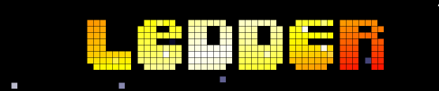

# Ledder

Make cool animated pixel animations, and stream it to a led matrix display.

Control in realtime via a webgui.

LIVE DEMO: https://ledder.datux.nl

Go to the [Wiki](https://github.com/psy0rz/ledder/wiki) for more info

## Overview picture

Ledder can control leds in multiple ways:

Go to the [Wiki](https://github.com/psy0rz/ledder/wiki) for more info

## Examples

Go to the [Wiki](https://github.com/psy0rz/ledder/wiki) for more info
